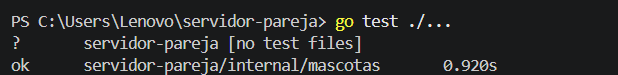
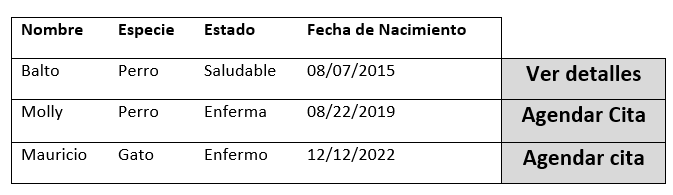
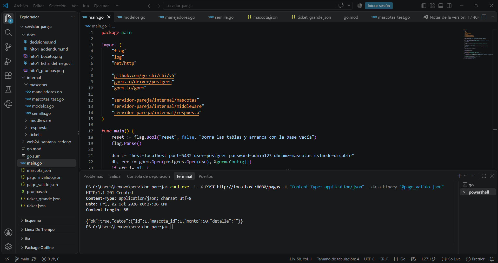
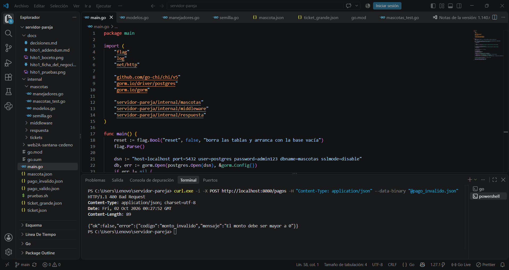

# Hito 1 · Addendum técnico

**Pareja:** Francisco Cedeño · Alexis Santana
**Paralelo:** A

## A. Estructura del proyecto

.
├── main.go                    #Punto de entrada de la aplicacion
├── go.mod                     #Dependencias y versión de Go
├── internal/
│   └── mascotas/              #Logica de Negocio
│       ├── modelos.go         #Structs de Usuario, Mascota, Cita, Tratamiento, Pago
│       ├── manejadores.go     #Funciones para endpoints (CRUD, validaciones)
│       └── rutas.go           #Definicion de rutas, diagramas y pruebas
└── docs/                       #Documentacion, diagramas y pruebas

## B. Configuración y secretos

| Variable  |          Para qué sirve           | Ejemplo (sin datos reales) |
|-----------|-----------------------------------|----------------------------|
| DB_HOST   | Dirección del servidor de BD      | localhost                  |
| DB_USER   | Usuario de la BD                  | demo_user                  |
| DB_PASS   | Contraseña de la BD               | demo_pass                  |
| DB_NAME   | Nombre de la base de datos        | mascotas_db                |
| PORT      | Puerto de ejecución del servidor  | 8080                       |

**Archivo de ejemplo:** .env.example

## C. Pruebas

|      Prueba    |                  Qué caso cubre              |
|----------------|----------------------------------------------|
| Crear mascota  | Valida datos obligatorios (nombre, especie)  |
| Listar mascotas| Devuelve todas las mascotas del dueño        |
| Registrar pago | Valida monto > 0 y comprobante único         |
| Agendar cita   | 	Fecha válida y mascota existente        |

**Captura de `go test ./...`:** 

## D. Boceto de la pantalla principal

## E. Diagrama de secuencia del caso de uso principal

sequenceDiagram
    Dueño->>Pantalla: selecciona "Registrar mascota"
    Pantalla->>API: POST /mascotas
    API->>BD: inserta nueva mascota
    BD-->>API: ok
    API-->>Pantalla: 201 con mascota creada

## F. Capturas de respuestas

**Caso correcto:** 

**Caso con error de validación:** 